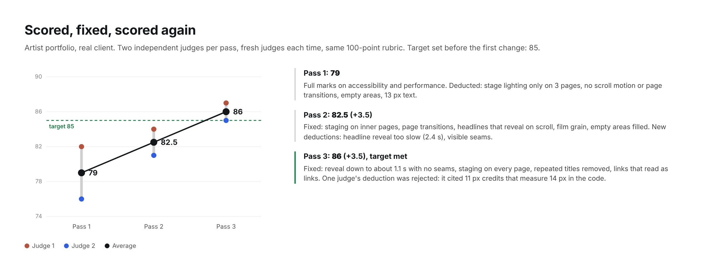
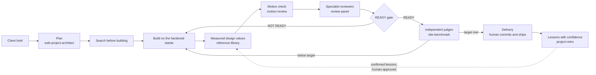
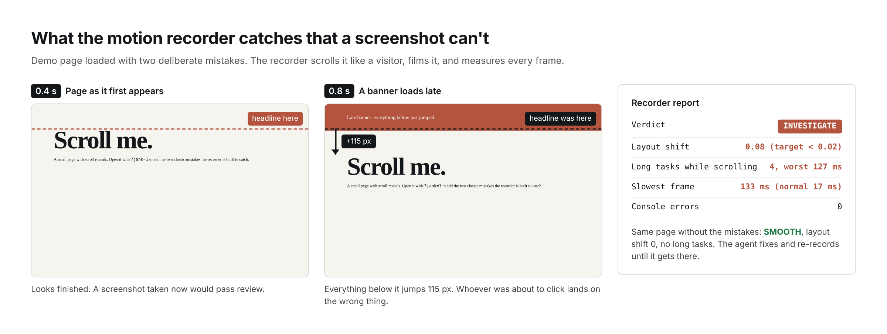

# Web Agency Agent

An AI agent I designed and direct, built on Claude (Anthropic), that takes a client brief to a shipped, verified website: planned, built on a hardened starter, reviewed by specialist sub-agents, scored by independent judges, and improved from its own lessons.

This repository is the public overview: how the system is put together, how it evaluates its own work, the guardrails, and one open-source tool. The skills themselves (methods, measured values, prompts, rubric details) and the starter stay private.

  [](https://github.com/stefanwakata/web-agency-agent/actions/workflows/motion-recorder.yml)



## In numbers

- **Redesigns scored before and after** by two independent judges on a fixed 100-point rubric: an artist portfolio for a real client went from 79 to 86 over three passes (chart above), a book-exchange platform from 67 to 78.5.
- **Hardened starter:** Lighthouse 100 in performance, accessibility, best practices and SEO; 33 unit and integration tests and 51 end-to-end tests including WCAG 2.2 AA checks with axe; layout shift 0.
- **Reference library:** six award-level sites measured in a real browser, down to reveal timings sampled frame by frame.

## How it works



Every arrow back is a loop the agent runs on its own until the work passes; the only exits are a passed gate and a human decision.

## The skills

Each skill is a written method the agent loads when the task calls for it. What each one solves, and the proof it leaves behind:

### Measured taste: `reference-library`
**Problem:** "Make it look premium" is not an instruction a model can check.
**Approach:** award-level sites measured in a real browser with a measurement script: type scale, spacing, easing curves, reveal start states, and reveal timings sampled every 50 ms (Apple's product pages, for example, finish the transform around 650 ms and the opacity around 900 ms). The values are grouped into three registers (product, studio, editorial) and every build picks one.
**Proof:** concrete values instead of adjectives in every design decision, plus a running list of pitfalls found on real builds.

### Eyes for motion: `motion-review`
**Problem:** screenshots cannot show animation, and an agent that cannot see motion ships stutter.
**Approach:** record the page while it scrolls, measure long tasks and layout shifts, review contact sheets frame by frame on desktop, mobile and reduced motion.
**Proof:** the recorder is open source in [`tools/motion-recorder`](tools/motion-recorder), with an end-to-end test in CI: the clean demo must come out SMOOTH and the broken one must be flagged. On real builds the sheets caught bugs that tests missed, such as split headlines whose words lost their spaces.



### Specialist reviewers: `review-panel`
**Problem:** one reviewer, human or model, misses whole categories of problems.
**Approach:** parallel sub-agents, each with one job (security code review, live attacker, design, accessibility and copy, motion and performance, tests). Every finding has to be reproduced before anything is fixed.
**Proof:** on the starter the panel found an over-privileged admin plugin, account enumeration through sign-up, account deletion without the password and IP-only rate limits; all fixed and covered by tests. It also discarded one confident but false finding after checking it against the code's syntax tree.

### Independent judges: `site-benchmark`
**Problem:** a model grading its own work is a weak signal.
**Approach:** a fixed 100-point rubric (identity, typography, layout, colour, motion, inner pages, mobile, accessibility, performance, copy). Two judges grade independently from screenshots, contact sheets and reports, and every deducted point must cite evidence. A third judge breaks ties when they disagree by more than 6 points. Targets and acceptance criteria are written before the first change, and a no-regression check runs after.
**Proof:** the chart at the top: every pass logged with its deductions, including one judge's deduction that was rejected because the code proved it wrong.

### The READY gate
**Problem:** "done" means different things on different days.
**Approach:** the same checks in the same order before anything reaches a human: build, types, lint, tests, a scan for secrets and stray attribution, a file-by-file diff review, and checksums proving the delivered files are the tested ones.

Example of the report format:

```text
Build    PASS
Types    PASS
Lint     PASS
Tests    PASS (33 unit, 51 e2e, axe 0)
Secrets  PASS
Diff     PASS (every changed file reviewed)
Checksum PASS
Overall  READY
```

### Learning from each project: `project-retro`
**Problem:** an agent that does not keep its lessons repeats its mistakes.
**Approach:** after each project, lessons are written with their evidence and a confidence score from 0.3 (seen once) to 0.9 (confirmed on three projects). A lesson moves into a skill at 0.7, after a second project confirms it, and only with my approval. No background observer and no automatic hooks: every lesson is visible and reviewable.

### Human in the loop: house standards
The agent prepares; I decide, commit and ship. It never handles passwords, sign-in links or reset links, never commits on my behalf, and never ships a secret. Admin access on every demo belongs to me alone.

## Why these choices

The reasoning behind the design (two judges instead of one, confidence scores instead of automatic memory, measured values instead of style adjectives, no hooks) is in [docs/design-decisions.md](docs/design-decisions.md).

## What stays private

The full skills, the measured reference values, the judges' prompts and rubric details, the lessons file and the starter. This repository shows what the system does and how it is evaluated, not the material that runs it.

## Tech the agent works with

Next.js 16, React 19, TypeScript, Postgres (Neon) with Drizzle, Better Auth, Astro for static sites, Reflex for Python dashboards, Playwright, axe-core, Lighthouse CI, GitHub Actions, Render.

## Author

**Stefan-Olivier Wakata**
[LinkedIn](https://www.linkedin.com/in/stefan-wakata-1610b6243/), [GitHub](https://github.com/stefanwakata)

The `tools/motion-recorder` folder is MIT licensed. Everything else in this repository is all rights reserved.
