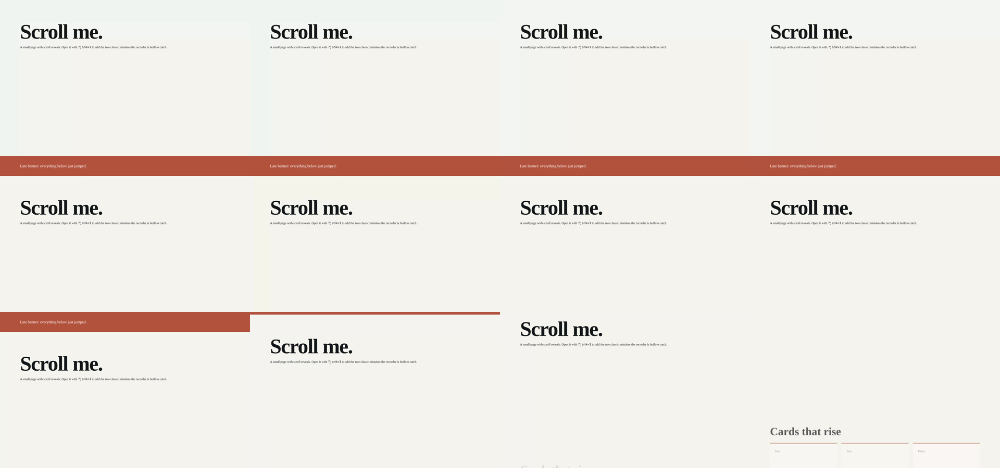

# motion-recorder

Screenshots cannot show motion. This tool scrolls a web page like a person, films it, measures how smooth it was, and turns the video into contact sheets so every animation can be reviewed frame by frame.

It is the open-source part of the agent's `motion-review` skill. The review rules and the measured reference values the agent judges against stay private.

## What it produces

| Output | Use |
|---|---|
| `report-<profile>.json` | Frame times (median, p95, max), long tasks split into *before scrolling* (load, hydration) and *while scrolling*, cumulative layout shift with timestamps, console errors, and a `SMOOTH` / `INVESTIGATE` verdict |
| `sheet-<profile>-NN.png` | Contact sheets, 12 frames each, read left to right like a comic strip |
| `frames-<profile>/NNN.png` | One still per screen after motion settles: does every screen look finished? |
| `video-<profile>.webm` | The full recording |

## Try it on the demo page

```bash
npm install
npx playwright install chromium ffmpeg   # skip if a Chromium is already set in CHROMIUM_PATH
npm run demo:serve                        # serves demo/index.html on http://localhost:4173
npm run demo:clean                        # in another terminal
npm run demo:jank                         # same page with two deliberate mistakes
```

The demo page has scroll reveals. With `?jank=1` it adds the two mistakes the tool is built to catch: heavy work inside a scroll handler, and a banner inserted after load that pushes the page down.

```text
SMOOTH       desktop  long tasks while scrolling: 0  CLS: 0     console errors: 0
INVESTIGATE  desktop  long tasks while scrolling: 4  CLS: 0.08  console errors: 0
  - 4 long task(s) while scrolling, worst 127 ms
  - layout shift 0.08 (target < 0.02)
```

The late banner, caught on the contact sheet (it appears, and every screen below it moves down):



## Use it on any site

```bash
node record.mjs https://example.com --out out/site
node record.mjs https://example.com --out out/site --profile mobile
node record.mjs https://example.com --out out/site --reduced-motion   # checks the prefers-reduced-motion path
```

Options: `--out <dir>`, `--profile desktop|mobile` (1440x900 or 390x844), `--reduced-motion`, `--step <px>` and `--wait <ms>` for the scroll rhythm. Set `CHROMIUM_PATH` to use an existing Chromium.

## Reading the numbers

Headless Chrome is not a real phone. Use the numbers to find problems and to compare two versions of the same page, not as absolute truth.

- **Long tasks while scrolling** are the signal that matters: any task over 50 ms during the scroll is a visible stutter. Long tasks before scrolling are loading and hydration; compare them with a page of the same site that has no motion before blaming an animation.
- **CLS** under 0.02 is the target; `shifts[].t` says when each jump happened, to match with the video.
- **Frame times** are noisy in headless runs, and WebGL scenes render in software here. Compare runs of the same setup only, and check WebGL on a real device.
- **Full-page stills:** Playwright's `fullPage: true` can drop animated and sticky layers in Chromium. The stills here are taken one screen at a time for that reason.

Requires Node 20+, Playwright and `ffmpeg` / `ffprobe` on the PATH.

## License

MIT, for this folder only.
